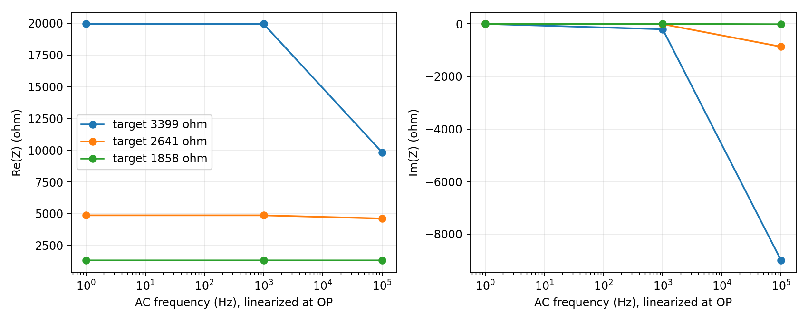
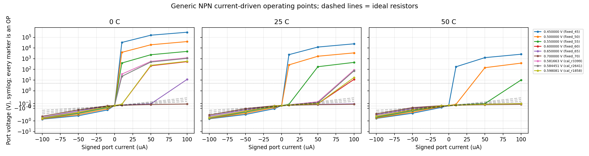
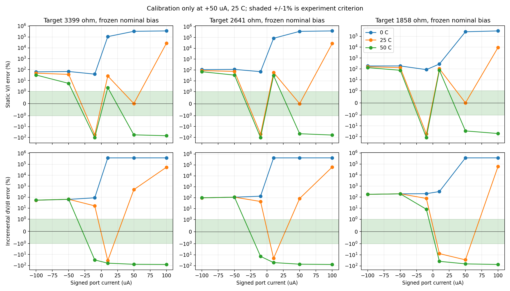

# BJT 表观电阻：真实 ngspice 参数扫描报告

正式扫描时间（Asia/Shanghai）：2026-10-14T19:50:28.514566+08:00

## 实测结论

此模型与拓扑未能在本次电流、温度与方向组合下稳定模拟三个目标电阻。在名义点调到正确 V/I 并不意味着在其他条件下等效为电阻。

该结论限定于本报告的 generic NPN 模型与外部基极偏置拓扑；不能推广为所有 BJT 电路都不可实现，也不预测 DS3930 或未知 HVAC 控制器。

## 电路、符号与实验边界

参考电路分别使用 3399 Ω、2641 Ω、1858 Ω 的真实 SPICE 电阻元件，温度系数未设置，因此在本实验中为理想恒值电阻。BJT 使用 ngspice 内建标准 Gummel–Poon NPN，显式模型参数保存在 circuits/bjt_resistance/。这是教学模型，不是厂商器件保证值，也不是 DS3930 内部模型。

BJT 集电极接测试端口、发射极接地，基极通过 10 kΩ 接外部偏置电压源。正电流定义为从地注入测试端口；测试负电流时保持器件和偏置的连接不变。这是一种带独立偏置电源的有源三端电路，不是隔离的无源两端电阻。

扫描 ±10、±50、±100 µA，0、25、50°C，以及固定偏置和一次校准后冻结的偏置。还测量零采样电流的开路端口偏移；零电流时 V/I 未定义，CSV 使用空值。每个目标仅在 25°C、+50 µA 校准一次。其他电流、温度和方向保持同一偏置，不逐点调参。

±5 V 是本次报告采用的示例评估窗口，不是 HVAC 实际供电或采样限制。超出窗口的数学解被保留并标记，不能当成可实现的工作点。模型没有雪崩击穿和自热；尤其不能把理想电流源驱动产生的大电压外推到真实器件。1% 误差只是探索用判据，不是已知的 HVAC 或 DS3930 产品规格。

## 静态与动态的区别

静态表观电阻 R_static = V_DC / I_DC。增量电阻 r_diff = dV/dI，以固定温度和偏置的对称 DC 电流扰动求差分，非零工作点 ΔI = 0.001|I|。AC 分析在相同工作点线性化，Z(f) = ΔV(f)/ΔI(f)，独立偏置电压源的 AC 值为零，但仍保留 10 kΩ 基极终端。

AC 的 1 µA 源是线性化分析的归一化系数，不代表另一次有限幅度瞬态。输出 1 Hz、1 kHz、100 kHz 的复阻抗。低频 Re(Z) 应与 DC 差分比较，高频 |Z| 是阻抗幅值，不能称作电阻。本实验未宣称完成某种未知 HVAC 采样波形的瞬态验证。

## 名义单点校准后的实测值

| 目标 Ω | 冻结偏置 V | 端口 V | V/I Ω | 静态误差 % | DC 差分 Ω | 1 Hz Re(Z) Ω |
| --- | --- | --- | --- | --- | --- | --- |
| 3399 | 0.5816631 | 0.16995 | 3399 | 4.087619e-10 | 19942.82 | 19933.96 |
| 2641 | 0.5844508 | 0.13205 | 2641 | -1.771916e-11 | 4872.895 | 4872.798 |
| 1858 | 0.5980813 | 0.0929 | 1858 | -1.565414e-12 | 1329.341 | 1329.34 |

## 冻结偏置后的全部非零电流条件

| 目标 Ω | 条件数 | 窗口内 | 静态误差 ≤1% 且窗口内 | 全部数学解最大静态误差 % | 全部数学解最大增量误差 % |
| --- | --- | --- | --- | --- | --- |
| 3399 | 18 | 14 | 1 | 355970.7 | 384879.4 |
| 2641 | 18 | 14 | 1 | 404816.6 | 441840.9 |
| 1858 | 18 | 15 | 1 | 310125.7 | 361756.1 |

上表的最坏值保留所有求解结果，包含超出窗口的非物理高压解。应结合下表的窗口标志判断，而不能把最坏值当作真实器件测量。

冻结偏置的 54 个非零条件中，动态 DC 差分误差 ≤1% 的条件数为 0。详见各条件误差 CSV。

### 电流与方向影响（25°C）

| 目标 Ω | 采样 µA | 端口 V | V/I Ω | 静态误差 % | DC 差分 Ω | ±5 V 内 |
| --- | --- | --- | --- | --- | --- | --- |
| 3399 | -100 | -0.5007141 | 5007.141 | 47.31217 | 5208.624 | 1 |
| 3399 | -50 | -0.2322618 | 4645.236 | 36.66479 | 5586.754 | 1 |
| 3399 | -10 | -0.01438498 | 1438.498 | -57.67879 | 3948.167 | 1 |
| 3399 | 10 | 0.04286582 | 4286.582 | 26.11302 | 2173.375 | 1 |
| 3399 | 50 | 0.16995 | 3399 | 4.087619e-10 | 19942.82 | 1 |
| 3399 | 100 | 89.46865 | 894686.5 | 26222.05 | 1837068 | 0 |
| 2641 | -100 | -0.4979994 | 4979.994 | 88.56471 | 5209.267 | 1 |
| 2641 | -50 | -0.2295157 | 4590.313 | 73.80966 | 5587.073 | 1 |
| 2641 | -10 | -0.01328746 | 1328.746 | -49.68779 | 3828.174 | 1 |
| 2641 | 10 | 0.04191148 | 4191.148 | 58.69551 | 2076.383 | 1 |
| 2641 | 50 | 0.13205 | 2641 | -1.771916e-11 | 4872.895 | 1 |
| 2641 | 100 | 73.96511 | 739651.1 | 27906.48 | 1681218 | 0 |
| 1858 | -100 | -0.4847265 | 4847.265 | 160.8861 | 5212.412 | 1 |
| 1858 | -50 | -0.2160921 | 4321.843 | 132.6072 | 5587.934 | 1 |
| 1858 | -10 | -0.00856639 | 856.639 | -53.89456 | 3288.254 | 1 |
| 1858 | 10 | 0.03815029 | 3815.029 | 105.3299 | 1714.435 | 1 |
| 1858 | 50 | 0.0929 | 1858 | -1.565414e-12 | 1329.341 | 1 |
| 1858 | 100 | 17.57532 | 175753.2 | 9359.267 | 1114123 | 0 |

### 温度影响（+50 µA，冻结名义偏置）

| 目标 Ω | 温度 °C | 端口 V | V/I Ω | 静态误差 % | ±5 V 内 |
| --- | --- | --- | --- | --- | --- |
| 3399 | 0 | 557.1756 | 1.114351e+07 | 327746.8 | 0 |
| 3399 | 25 | 0.16995 | 3399 | 4.087619e-10 | 1 |
| 3399 | 50 | 0.07253895 | 1450.779 | -57.31748 | 1 |
| 2641 | 0 | 486.8531 | 9737061 | 368588.4 | 0 |
| 2641 | 25 | 0.13205 | 2641 | -1.771916e-11 | 1 |
| 2641 | 50 | 0.07131686 | 1426.337 | -45.99253 | 1 |
| 1858 | 0 | 240.8588 | 4817176 | 259166.8 | 0 |
| 1858 | 25 | 0.0929 | 1858 | -1.565414e-12 | 1 |
| 1858 | 50 | 0.06622532 | 1324.506 | -28.71333 | 1 |

### 零采样电流偏移（25°C）

| 目标 Ω | 偏置 V | 零电流端口 V | 基极 A |
| --- | --- | --- | --- |
| 3399 | 0.5816631 | 0.01859762 | 4.899589e-06 |
| 2641 | 0.5844508 | 0.01859926 | 5.082305e-06 |
| 1858 | 0.5980813 | 0.01860683 | 6.006226e-06 |

参考真实电阻的最大静态相对误差为 2.220446e-14%。所有参考与 BJT 条件均保存在 CSV 中，包含电压、电流、偏置和温度。

## 物理解释与限制

固定基极偏置并不控制一个线性的 C–E 电阻：前向有源区的集电极主要表现为电流源，Early 效应给出输出增量电阻；进入饱和或改变方向后，BC/BE 结及反向增益参与导通，V/I 和 dV/dI 会不同。偏置温度漂移来自结电流的温度依赖与固定电压偏置。

端口电流为负而端口电压仍为正时，V/I 为负、V×I 为负，表示外部偏置电源向测量端供能；它不具有普通正值无源电阻的双向特性。负的静态 V/I 不等于动态负阻，仍应独立查看 dV/dI 和 Re(Z)。判断控制器可否兼容还需要实际采样方向、波形、允许电压、温度误差和端口隔离需求。本报告不假设这些未知条件，亦不通过逐点校准强行制造等效电阻。

以下是实际观察到的反向采样、正端口电压条件；端口功率按电流进入端口为正。

| 目标 Ω | °C | 采样 µA | 端口 V | V/I Ω | dV/dI Ω | 端口吸收 W | 偏置提供 W |
| --- | --- | --- | --- | --- | --- | --- | --- |
| 3399 | 50 | -10 | 0.0004182527 | -41.82527 | 2329.544 | -4.182527e-09 | 5.963202e-06 |
| 2641 | 50 | -10 | 0.0009026255 | -90.26255 | 2269.727 | -9.026255e-09 | 6.097239e-06 |
| 1858 | 50 | -10 | 0.003016285 | -301.6285 | 2007.604 | -3.016285e-08 | 6.784618e-06 |

## 数值验证、版本、警告及失败

以下为测试程序的实际汇总记录；真实运行的命令、退出码、警告、原始 deck/日志/数据及 SHA-256 以 manifest 和归档保存。求解器成功与电阻模拟成功是两个不同结论。

```json
{
  "timestamp_utc": "2026-10-14T11:50:28.514566+00:00",
  "passed": true,
  "command": "/workspace/spice-lab/.venv/bin/python /workspace/spice-lab/scripts/simulate_bjt_resistance.py --output-dir /workspace/spice-lab/examples/bjt_resistance --ngspice ngspice",
  "source_sha256": {
    "scripts/simulate_bjt_resistance.py": "4280d3fbd56b8cb87816c2f674beeb1367354cd8409897f3b48c0e15ee878d58",
    "circuits/bjt_resistance/bjt_current_probe.cir.in": "620c94f811ae05d9f73613ac6e72be4d218f801615bd841557ce76f00f33e94b",
    "circuits/bjt_resistance/bjt_voltage_calibration.cir.in": "a1fd0c5f1cfe2548c2e4e484e90a95419b4526e2c5306af843e506f5bc1bf453",
    "circuits/bjt_resistance/resistor_reference.cir.in": "c20e1134c492929650830db7bf234c8389898c6768a9a4880bb93d78d1551a1b",
    "circuits/bjt_resistance/generic_npn.lib": "84a259c33ae6d1d380d82c932270315f3fbf59fd3a2543d29acc1f6280314422"
  },
  "versions": {
    "python": "3.12.14",
    "platform": "Linux-6.18.44-x86_64-with-glibc2.41",
    "numpy": "2.3.5",
    "scipy": "1.17.0",
    "matplotlib": "3.10.8",
    "pandas": "2.2.3",
    "ngspice": "ngspice-44.2 : Circuit level simulation program"
  },
  "parameters": {
    "target_ohm": [
      3399.0,
      2641.0,
      1858.0
    ],
    "temperature_c": [
      0.0,
      25.0,
      50.0
    ],
    "sample_current_a": [
      -0.0001,
      -5e-05,
      -1e-05,
      0.0,
      1e-05,
      5e-05,
      0.0001
    ],
    "fixed_bias_v": [
      0.45,
      0.5,
      0.55,
      0.6,
      0.65,
      0.7
    ],
    "ac_frequency_hz": [
      1,
      1000,
      100000
    ],
    "ac_current_a": 1e-06,
    "voltage_window_v": 5.0,
    "gmin_s": 1e-12,
    "finite_difference_fraction": 0.001,
    "zero_current_delta_a": 1e-10
  },
  "checks": {
    "all_scan_conditions_computed": true,
    "all_ac_observations_computed": true,
    "reference_static_error_below_1e-6_percent": true,
    "reference_ac_relative_error_below_1e-8": true,
    "nominal_calibration_error_below_1e-4_percent": true,
    "port_kcl_residual_below_1e-12_a": true,
    "in_window_device_kcl_residual_below_1e-12_a": true,
    "model_kcl_gmin_adjusted_residual_below_1e-12_a": true,
    "in_window_low_frequency_ac_matches_fd_within_1_percent": true,
    "no_ngspice_execution_errors": true
  },
  "calibrations": [
    {
      "target_ohm": 3399.0,
      "temperature_c": 25,
      "nominal_current_a": 5e-05,
      "clamped_port_voltage_v": 0.16995000000000002,
      "calibrated_bias_v": 0.5816630992498681,
      "measured_port_current_a": 4.999999999996674e-05,
      "residual_a": -3.326467790457088e-17,
      "ngspice_evaluations": 15
    },
    {
      "target_ohm": 2641.0,
      "temperature_c": 25,
      "nominal_current_a": 5e-05,
      "clamped_port_voltage_v": 0.13205,
      "calibrated_bias_v": 0.5844508316056654,
      "measured_port_current_a": 4.999999999999449e-05,
      "residual_a": -5.5091022889419694e-18,
      "ngspice_evaluations": 15
    },
    {
      "target_ohm": 1858.0,
      "temperature_c": 25,
      "nominal_current_a": 5e-05,
      "clamped_port_voltage_v": 0.09290000000000001,
      "calibrated_bias_v": 0.5980813495315046,
      "measured_port_current_a": 4.999999999999449e-05,
      "residual_a": -5.5091022889419694e-18,
      "ngspice_evaluations": 14
    }
  ],
  "counts": {
    "scan_conditions": 252,
    "successful_scan_conditions": 252,
    "bjt_conditions": 189,
    "reference_conditions": 63,
    "ac_observations": 756,
    "comparison_rows": 432,
    "zero_current_points": 36,
    "out_of_window_bjt_points": 38,
    "ngspice_processes": 298,
    "warning_runs": 0,
    "failed_runs": 0
  },
  "measurements": {
    "max_reference_static_error_percent": 2.220446049250313e-14,
    "max_nominal_static_error_percent": 4.0876191320649014e-10,
    "max_in_window_lowfreq_fd_relative_difference": 0.00044394572114888996,
    "max_port_kcl_residual_a": 1.3552527156068805e-20,
    "max_device_kcl_residual_a": 2.968265991778031e-07,
    "max_in_window_device_kcl_residual_a": 6.801692455787878e-13,
    "max_model_kcl_gmin_adjusted_residual_a": 1.0005385641455206e-16
  },
  "nominal_points": [
    {
      "comparison_target_ohm": 3399.0,
      "bias_v": 0.5816630992498681,
      "port_voltage_v": 0.1699500000006947,
      "port_current_a": 5e-05,
      "apparent_resistance_ohm": 3399.000000013894,
      "incremental_fd_ohm": 19942.815220646837,
      "static_error_percent": 4.0876191320649014e-10,
      "incremental_error_percent": 486.72595529999523
    },
    {
      "comparison_target_ohm": 2641.0,
      "bias_v": 0.5844508316056654,
      "port_voltage_v": 0.1320499999999766,
      "port_current_a": 5e-05,
      "apparent_resistance_ohm": 2640.999999999532,
      "incremental_fd_ohm": 4872.894986990838,
      "static_error_percent": -1.77191594730175e-11,
      "incremental_error_percent": 84.50946561873678
    },
    {
      "comparison_target_ohm": 1858.0,
      "bias_v": 0.5980813495315046,
      "port_voltage_v": 0.09289999999999854,
      "port_current_a": 5e-05,
      "apparent_resistance_ohm": 1857.9999999999707,
      "incremental_fd_ohm": 1329.341103619014,
      "static_error_percent": -1.5765166949677223e-12,
      "incremental_error_percent": -28.453116059256523
    }
  ]
}
```

诊断统计：

```json
{
  "warning_run_count": 0,
  "failure_run_count": 0,
  "unique_warning_messages": []
}
```

逐次诊断见 [完整汇总](simulation_summary.json) 与 [执行清单](run_manifest.jsonl)。

### gmin 敏感性复验

这是检查数值漏导敏感性的额外实际求解；改变 gmin 不会补上缺失的击穿或自热模型。本模型的三端写法默认将衬底接地，相关数值 gmin 支路电流未计入仅三端的电流读出之和。高压三端残差不能被解释成电荷守恒破坏；补充四端对照可单独读取该数值衬底电流。

| comparison | gmin_s | port_voltage_v | incremental_fd_ohm | voltage_ratio_to_baseline | within_voltage_window | status |
| --- | --- | --- | --- | --- | --- | --- |
| extreme_out_of_scope | 1e-12 | 296801.3 | 2.64601e+09 | 1 | 0 | passed |
| extreme_out_of_scope | 1e-14 | 338626.4 | 3.397404e+09 | 1.14092 | 0 | passed |
| calibrated_nominal | 1e-12 | 0.13205 | 4872.895 | 1 | 1 | passed |
| calibrated_nominal | 1e-14 | 0.1320499 | 4872.882 | 0.9999994 | 1 | passed |

### 默认衬底数值支路的实际四端对照

另执行 8 次 OP，把同一器件的默认接地衬底改为显式第四端并加零伏测流源。两个连接方式的工作点相同；计入实测衬底电流后，极端数学解的三端读出不平衡降为符合相对求解容差的剩余残差。

| 条件 | gmin S | 端口 V | 衬底流出 A | 仅三端和 A | 计入衬底后残差 A |
| --- | --- | --- | --- | --- | --- |
| extreme | 1e-12 | 296801.3 | 2.968013e-07 | 2.968266e-07 | 2.531013e-11 |
| extreme | 1e-14 | 338626.4 | 3.386264e-09 | 3.368611e-09 | -1.765328e-11 |
| nominal | 1e-12 | 0.13205 | 1.32e-13 | 1.320157e-13 | 1.567525e-17 |
| nominal | 1e-14 | 0.1320499 | 1.319999e-15 | 1.328459e-15 | 8.460104e-18 |

[补充报告](substrate_diagnostic/report.md)记录符号、检查门限、软件版本、官方实现参考、实际命令以及开发期间请求不可用内部向量的失败。该补充没有把数值 gmin 电流视作真实器件的衬底漏电或击穿。

## Code Model 环境修复

旧 RC 日志保留了六个库加载失败的证据。原因是 rootless 解包后，包内 spinit 仍使用 /usr/lib/... 的系统绝对路径。安装脚本保持包内文件不变，在 .local/ngspice-runtime/spinit 生成重定位配置，并由 wrapper 设置 ngspice 官方支持的 SPICE_SCRIPTS。

独立验证见 [Code Model 测试报告](../code_model_validation/model_report.md)。验证包含库动态链接依赖、模型注册及真实 analog/digital 电路计算。BJT 标准 NPN 是 ngspice 内建器件，BJT 或 RC 通过本身不能证明 XSPICE 库已加载。OSDI 默认仍未启用，本次没有宣称 OSDI 插件已验证。

## 复现与产物

```bash
cd /workspace/spice-lab
bash scripts/run_bjt_experiment.sh
```

若需刷新此实验分支的修复配置，先执行 bash scripts/setup_env.sh。使用当前现有环境与检出目录，不初始化新仓库或环境。

### 开发期间的检查失败

首次开发扫描得到真实工作点，但初始校验未全部通过。高压下仅三端的电流输出之和没有计入默认接地衬底的数值 gmin 支路，不能把这个三端读出残差解释为电荷守恒失败；修正版加入独立的发射极零伏测流源验证外部 KCL，保留 intrinsic 残差供诊断。第二轮的三端零伏传感器仍未测量默认接地衬底，因此读出残差仍包含衬底 gmin 电流。最终版本将严格物理 KCL 验证限定在明确的 ±5 V 示例窗口，同时报告全域残差及 gmin 修正诊断，没有把高压数据静默删除。此外零采样点的初始 ±10 nA 差分扰动在高阻工作点不够小，因此仅将零点扰动改为 ±0.1 nA，并再次实际求解与 AC 交叉验证。非零采样点仍使用 ±0.1% 扰动。

初次开发检查：

```json
{
  "all_scan_conditions_computed": true,
  "all_ac_observations_computed": true,
  "reference_static_error_below_1e-6_percent": true,
  "reference_ac_relative_error_below_1e-8": true,
  "nominal_calibration_error_below_1e-4_percent": true,
  "port_kcl_residual_below_1e-12_a": true,
  "device_kcl_residual_below_1e-12_a": false,
  "in_window_low_frequency_ac_matches_fd_within_1_percent": false,
  "no_ngspice_execution_errors": true
}
```

[初次扫描记录](development_attempt/first_run/simulation_summary.json)及执行清单单独保留，不将初次失败的校验描述为通过。

第二轮开发检查：

```json
{
  "all_scan_conditions_computed": true,
  "all_ac_observations_computed": true,
  "reference_static_error_below_1e-6_percent": true,
  "reference_ac_relative_error_below_1e-8": true,
  "nominal_calibration_error_below_1e-4_percent": true,
  "port_kcl_residual_below_1e-12_a": true,
  "device_kcl_residual_below_1e-12_a": false,
  "in_window_low_frequency_ac_matches_fd_within_1_percent": true,
  "no_ngspice_execution_errors": true
}
```

详细记录见 [开发诊断说明](development_attempt/README.md)。



工作点图的 ±5 V 水平线标示示例窗口。全部圆点为真实工作点，窗口外数学解同样显示以保留诊断证据。



误差图包含保留的窗口外数学解；极大误差来自无击穿模型外推，不是真实器件预测。图中圆点是实际求解点，连接线仅辅助观察，没有单独把窗口外圆点标成不同符号；请结合 CSV 的 within_voltage_window 列。



数据：[工作点](operating_points.csv)、[复阻抗](impedance.csv)、[各目标误差](resistance_comparisons.csv)、[单点校准](calibration.csv)、[零电流偏移](offset.csv)。
